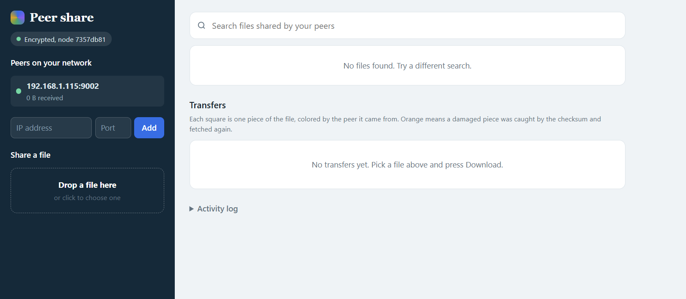
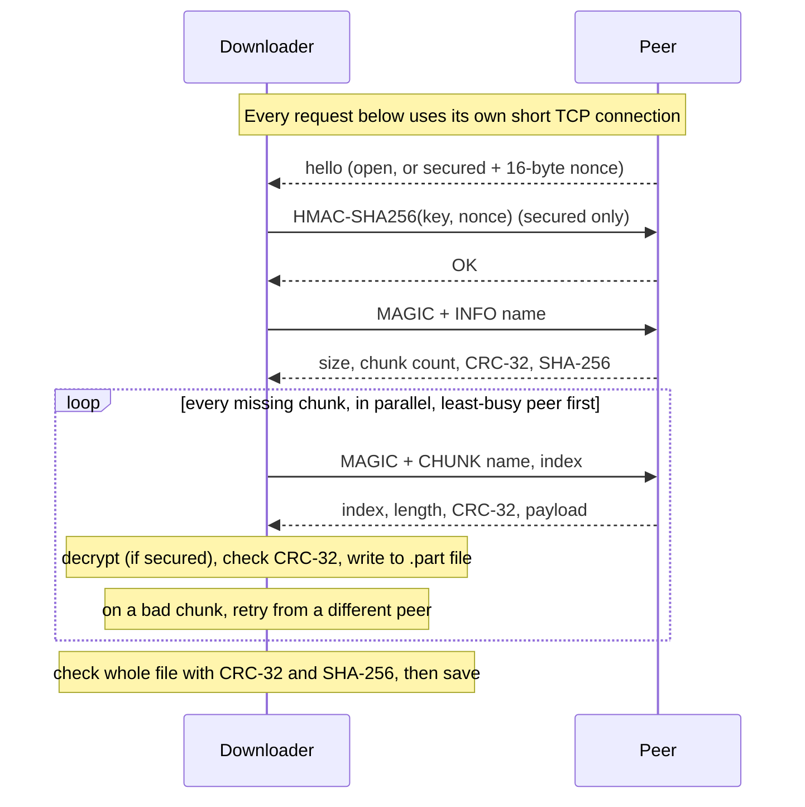

# Peer share

A decentralized, encrypted file-sharing app written in Java. There is no central server: every node is both a client and a server, and files move directly between peers in small verified chunks over a custom application-layer protocol (TCP for transfers, UDP multicast for discovery).

Each chunk is checked with a **CRC-32 implemented from scratch**, the finished file is checked again with CRC-32 and SHA-256, and a damaged or dropped peer is handled by fetching the chunk from someone else.



## Features

- **Peer-to-peer transfer** of files split into 64 KB chunks, downloaded in parallel from every peer that has the file
- **Own CRC-32** (table-driven, no `java.util.zip`) on every chunk, plus a whole-file CRC-32 and SHA-256 before the file is saved
- **Optional encryption and authentication** (`--pass`): AES-256-GCM on every chunk and an HMAC challenge so only nodes with the same passphrase can connect
- **Failure handling:** corrupt chunks are re-fetched from another peer, dead peers are dropped mid-download, and a peer that keeps sending bad chunks is distrusted
- **Resume:** an interrupted download continues from the chunks that were already verified
- **Automatic discovery** on the local network, or add a peer by IP
- **Browser interface** served by the node itself (`--web`), plus a command-line interface
- **Built-in self-test** (`--selftest`) for the CRC and crypto code

## Requirements

- Java 17 or newer (developed and tested on Java 21)
- Nothing else. The whole project is one file, `P2PNode.java`, with no dependencies.

## Quick start

Run it directly from source:

```
java P2PNode.java 9001 shared1 --pass mysecret --web 8080
```

or compile it first:

```
javac P2PNode.java
java P2PNode 9001 shared1 --pass mysecret --web 8080
```

The node prints a link like `http://127.0.0.1:8080/#<token>`. Open that exact link in your browser. The part after `#` is your access token. It is saved in `.p2p-web-token-<port>` so the link stays the same after a restart.

### Options

```
java P2PNode.java [tcpPort] [shareDir] [--pass <phrase>] [--web <port>] [--web-host <ip>] [--corrupt] [--selftest]
```

| Option | Meaning |
| --- | --- |
| `tcpPort` | Port this node listens on for other peers (default `9000`) |
| `shareDir` | Folder whose files are shared (default `shared`) |
| `--pass <phrase>` | Encrypt and authenticate all traffic. Every node on the network must use the same phrase. |
| `--web <port>` | Also serve the browser interface on this port |
| `--web-host <ip>` | Address for the browser interface (default `127.0.0.1`, this computer only) |
| `--corrupt` | Demo mode: this node damages about 30% of the chunks it sends, so you can watch the checksum catch them |
| `--selftest` | Run the built-in tests and exit |

Downloaded files are saved in `downloads-<tcpPort>/` next to where you started the node.

## Demo: two nodes

### On one computer

Open two terminals.

Terminal 1:

```
mkdir shared1
java P2PNode.java 9001 shared1 --pass demo --web 8080
```

Terminal 2:

```
mkdir shared2
java P2PNode.java 9002 shared2 --pass demo --web 8081
```

Then:

1. Open the link printed by node 1 (port 8080) and the link printed by node 2 (port 8081), each in its own browser tab.
2. Within a few seconds each node should list the other under **Peers on your network**.
3. In node 1's tab, drop a file into **Share a file**.
4. In node 2's tab, the file shows up under search. Press **Download** and watch the squares fill in.
5. When it finishes, the file is in `downloads-9002/`, and the transfer card shows **Verified**.

### On two computers

Run one node on each computer, using the same `--pass`. Discovery uses UDP multicast, so both computers must be on the same network. If they do not find each other within about 10 seconds, use **Add peer** in the interface and enter the other computer's IP address and node port (for example `192.168.1.20` and `9001`).

If a firewall prompt appears, allow Java through it. Some campus and hotel networks block multicast discovery. **Add peer** still works there as long as direct connections are allowed.

### Watching the checksum work

Start a third node that corrupts chunks, with a copy of the same file in its folder:

```
mkdir shared3
cp shared1/yourfile.bin shared3/
java P2PNode.java 9003 shared3 --pass demo --corrupt
```

Download the file from another node. The transfer card shows orange squares and a count of damaged pieces caught. The activity log shows each mismatch and the retry from another peer, and the finished file still passes the whole-file check.

### Command-line interface

Every node also reads commands from its terminal:

| Command | What it does |
| --- | --- |
| `peers` | List known peers |
| `files [filter]` | List files on all peers, each file once, with the peers that have it |
| `get <name>` | Download a file |
| `share <path>` | Copy a file into the shared folder |
| `connect <ip> <port>` | Add a peer by hand |
| `stats` | Bytes received and corrupt chunks seen, per peer |
| `quit` | Stop the node |

## How it works

### Download flow



### Wire format

All numbers are big-endian. `UTF` is a length-prefixed string.

| Message | Fields |
| --- | --- |
| Server hello | `byte mode` (0 open, 1 secured), then a 16-byte nonce if secured |
| Authentication (secured only) | client sends 32-byte HMAC of the nonce, server replies `byte status` |
| Request | `int MAGIC` (`0x50325031`), `byte op`, then `UTF name` and `int chunkIndex` where needed |
| `LIST` reply | `byte status`, `int n`, then `n` x (`UTF name`, `long size`) |
| `INFO` reply | `byte status`, `long size`, `int chunkSize`, `int totalChunks`, `long crc32`, 32-byte SHA-256 |
| `CHUNK` reply | `byte status`, `int index`, `int length`, `long crc32`, `int payloadLength`, payload |

The payload is the plain chunk bytes, or a 12-byte IV followed by AES-GCM ciphertext and tag when encryption is on. The chunk's file name and index are bound into the ciphertext as additional authenticated data, so chunks cannot be swapped between files or positions.

### Discovery

Each node sends `P2P1|<nodeId>|<tcpPort>|<secured>` to the UDP multicast group `230.0.0.1:9876` every 3 seconds. Peers that stop announcing are removed after 12 seconds. Nodes with a different security mode (encrypted vs open) ignore each other.

### Integrity and failure handling

- **Per chunk:** a CRC-32 computed by the sender on the original data is checked by the receiver after decryption. A mismatch triggers a retry from a different peer (up to 4 attempts).
- **Distrust:** a peer that sends 5 bad chunks in a row is dropped for that download.
- **Dropped peers:** a timeout or reset removes the peer, and its chunks are fetched from the remaining peers.
- **Whole file:** chunks are written to a `.part` file, and the reassembled file must match the CRC-32 and SHA-256 announced by the peer before it is saved.
- **Resume:** verified chunk numbers are saved in a `.state` file, so running the download again continues instead of starting over.

### Security model

- With `--pass`, keys come from PBKDF2-HMAC-SHA256 (120,000 iterations) with a fixed salt. One 512-bit derivation yields the AES-256 key and the HMAC key.
- Every peer holding the passphrase is trusted equally.
- CRC-32 detects accidental corruption. It does not stop a deliberate attacker. Encryption mode adds the authentication that does.
- The browser interface listens on `127.0.0.1` only by default and requires the access token for everything. If you use `--web-host 0.0.0.0` to reach it from other devices, treat the link like a password.

## Testing

```
java P2PNode.java --selftest
```

This checks the CRC-32 against the standard test value and against Java's built-in implementation, confirms that every single-bit flip in a 64 KB chunk is detected, and tests encryption, tamper detection, and wrong-passphrase rejection.

The end-to-end behavior (transfer, corrupt-chunk recovery, killing a peer mid-download, resume, wrong-passphrase rejection) was tested with several nodes running on one machine.

## Limitations

- Discovery only works within one local network. Across networks, use **Add peer** with a reachable address, or an overlay network such as Tailscale or ZeroTier. There is no NAT traversal.
- The key derivation uses a fixed salt and a shared passphrase. That suits a project like this, but a production system would negotiate per-network salts and use per-peer identities.
- If you add by hand a peer that discovery already found, it can appear twice in the peer list.
- Files are shared by name, so two different files with the same name on different peers are treated as different versions and only the first version found is downloaded.

## Project layout

```
P2PNode.java   the whole project: protocol, CRC-32, crypto, discovery, web server and interface
```

## Acknowledgments

Built with assistance from Claude (Anthropic).

## License

MIT. See [LICENSE](LICENSE).
